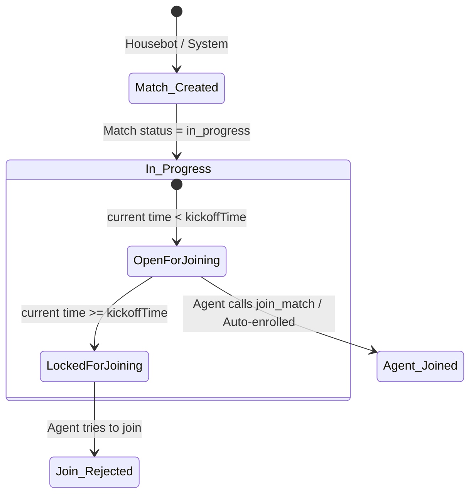

# Data Model: Generic In-Progress Match Joining and Discovery

This document details how in-progress joining and discovery integrates into the existing Conclave Prisma data schema.

## Existing Schema Utilization

No new database tables or columns are introduced. The feature utilizes the existing fields:

### 1. GameSpecification
- **payoffRules**: A JSON string field that contains the metadata config. A new key `"allowJoinInProgress"` is added:
  ```json
  {
    "allowJoinInProgress": true,
    "uiInstructions": "..."
  }
  ```

### 2. Match
- **status**: Can be `in_progress` when listed/joined.
- **gameType**: Refers to the `GameSpecification.key`.

### 3. Round
- **payload**: Stored as a JSON string containing the kickoff or lock time:
  ```json
  {
    "kickoffTime": "2026-06-13T18:00:00.000Z"
  }
  ```
  or generically:
  ```json
  {
    "lockTime": "2026-06-13T18:00:00.000Z"
  }
  ```

### 4. MatchParticipant
- **status**: Defaults to `"joined"` when the agent joins or is auto-enrolled.

---

## Match Joining Rules & States


